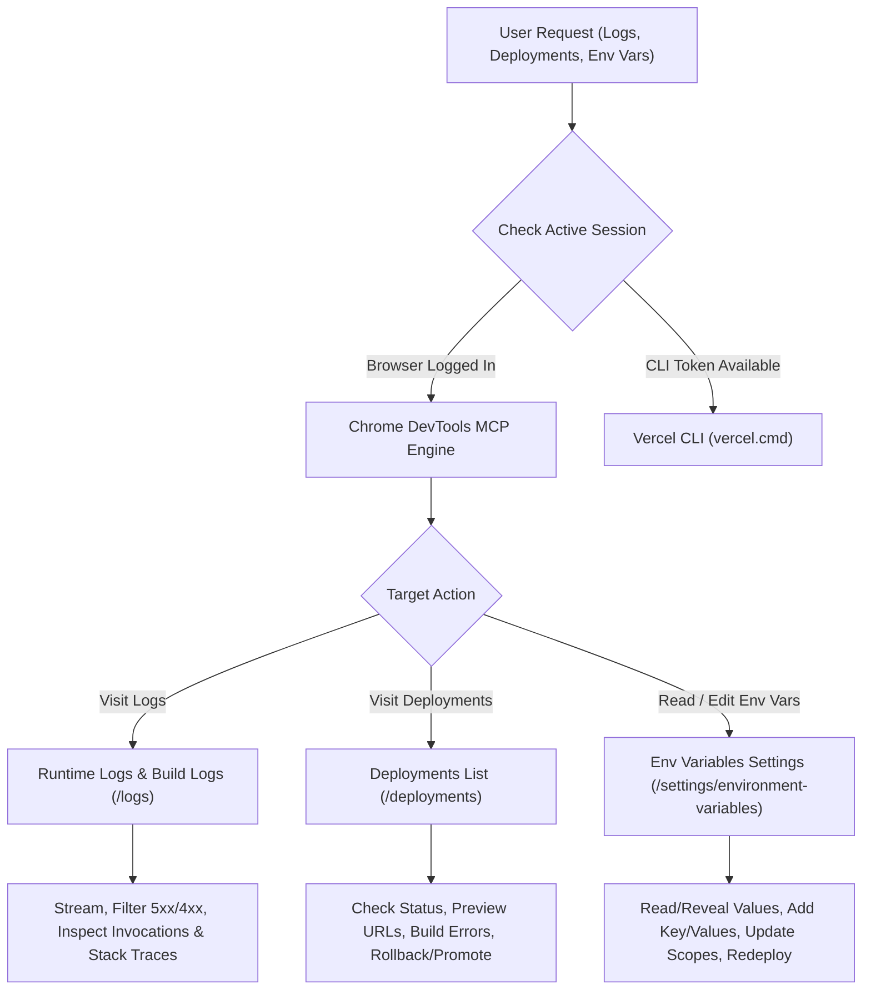

# Vercel Project Management Skill

This skill teaches the agent how to manage Vercel projects using **Chrome DevTools MCP** (`chrome-devtools-mcp`) for browser automation on `vercel.com`, with complementary terminal support via the **Vercel CLI** (`vercel.cmd`).

---

## 1. Core Workflow Architecture



### DevTools MCP Interaction Standard
Every browser action must strictly adhere to the DevTools interaction lifecycle:
1. **Find or Open Page**: `list_pages` to find existing Vercel tabs, or `new_page(url: "...")` to open target view.
2. **Wait for Hydration**: `wait_for(pageId: <id>)` to allow client-side components to render.
3. **Capture Snapshot**: `take_snapshot(pageId: <id>)` to extract element `uid`s.
4. **Interact**: Use element `uid`s for `click`, `fill`, `type_text`, `press_key`, or execute DOM queries via `evaluate_script`.

---

## 2. Visiting & Analyzing Logs

Detailed guide: [Runtime & Function Logs Guide](./references/runtime-logs.md)

### Runtime Logs (`/logs`)
1. Navigate to: `https://vercel.com/<team>/<project>/logs`
2. **Pause Live Flow**: If logs are streaming fast, locate the `Live` button in the snapshot and `click` Pause to stabilize element UIDs.
3. **Filter Errors**:
   - Status Filter: Select `5xx` to isolate server crashes or unhandled exceptions.
   - Search Query: Use `fill` on the search input (`input[placeholder*="Search"]`) with error keywords (e.g. `TypeError`, `timeout`, `ECONNREFUSED`).
4. **Inspect Invocation Drawer**:
   - `click` the failing log row.
   - Read execution latency, allocated memory, request headers, response payload, and runtime stack trace.
5. **Quick Extraction**:
   To retrieve visible log lines cleanly without snapshot truncation, run `evaluate_script`:
   ```javascript
   () => Array.from(document.querySelectorAll('[data-testid="log-row"], [class*="log-row"]')).map(el => el.innerText.trim()).filter(Boolean).slice(-30)
   ```

### Build Logs (For Build Failures)
1. Navigate to: `https://vercel.com/<team>/<project>/deployments`
2. Click on the deployment with status `Error`.
3. Open the **Building / Build Logs** section.
4. Extract failure root causes (e.g., missing dependencies, TypeScript compile errors, missing environment variables during Next.js SSG).

---

## 3. Visiting & Managing Deployments

Detailed guide: [Deployment Workflows Guide](./references/deployment-workflows.md)

### Inspecting Deployments
1. Navigate to: `https://vercel.com/<team>/<project>/deployments`
2. Take snapshot to list deployments. Extract:
   - **Status**: `Ready` (deployed), `Building` (active), `Error` (failed), `Canceled`.
   - **Environment**: Production (`main`/`master`) vs Preview (branches / pull requests).
   - **Preview URL**: Assigned preview domain (e.g. `https://my-app-git-branch-team.vercel.app`).
   - **Commit details**: Git commit message, author, and timestamp.

### Deployment Operations
- **Promote to Production**: Open preview deployment detail -> Click `Promote to Production` -> Confirm modal.
- **Instant Rollback**: In `/deployments`, click action menu `...` on the last known stable deployment -> Click `Rollback to this deployment` -> Confirm.
- **Redeploy**: Click action menu `...` on deployment -> `Redeploy` (with or without cache).

---

## 4. Reading & Editing Environment Variables

Detailed guide: [Environment Variables Management Guide](./references/environment-variables.md)

Direct URL:
```text
https://vercel.com/<team>/<project>/settings/environment-variables
```

### Reading & Auditing Environment Variables
1. Navigate to `/settings/environment-variables`.
2. Take snapshot to list configured keys and their scopes (`Production`, `Preview`, `Development`).
3. **Revealing Sensitive Values**:
   - Find the eye icon / `Show` button next to a masked value (`••••••••`).
   - `click` the eye icon.
   - Take a new snapshot or inspect text to retrieve the revealed secret value.
4. **Audit**: Compare against local `.env.example` or required API keys to detect missing variables.

### Adding a New Variable
1. Locate input fields at top of table:
   - Key: `fill(pageId: <id>, uid: "<key-uid>", value: "MY_KEY")`
   - Value: `fill(pageId: <id>, uid: "<val-uid>", value: "my-value")`
2. Select target scopes (`fill(..., value: "true")` on checkboxes: Production, Preview, Development).
3. `click` the **Save** / **Add** button.
4. Verify success toast and new row in table snapshot.

### Editing an Existing Variable
1. Find the variable row in snapshot.
2. `click` the three-dots action menu `...` -> select **Edit**.
3. Update value or toggle target environments.
4. `click` **Save**.

> [!IMPORTANT]
> **Trigger Redeploy After Env Changes**: Environment variable changes do **not** take effect automatically on existing builds. You must trigger a redeploy or push a new commit for running workloads to pick up updated values.

### Deleting a Variable
1. Confirm with the user first if the variable is in Production.
2. Click row action menu `...` -> **Delete** -> Confirm deletion modal.

---

## 5. Companion CLI Support

Detailed guide: [Vercel CLI Cheat Sheet](./references/cli-reference.md)

On Windows PowerShell, run via `vercel.cmd`:
- **Logs**: `vercel.cmd logs [deployment-url] -f`
- **Deployments**: `vercel.cmd list`
- **Env Vars List**: `vercel.cmd env ls`
- **Env Vars Pull**: `vercel.cmd env pull .env.local`
- **Env Var Add**: `vercel.cmd env add <KEY> [production|preview|development]`

---

## 6. Helper Scripts

- [extract_vercel_dom.js](./scripts/extract_vercel_dom.js): Reusable evaluation script for `evaluate_script` to extract clean JSON lists of deployments, logs, and environment variables directly from page DOM.
